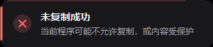

# CopyCheck · 复制核对

> 复制之后，告诉你到底复制上了没有。

按 Ctrl+C 之后弹一个提示的工具有不少，但绝大多数只做了一件事：**你按了键，它就夸你复制成功了**。

问题是——你按了键，和剪贴板真的被写入，是两件不同的事。远程桌面断连、程序禁止复制、剪贴板被占用的时候，按键照样会到达系统，提示照样会弹，而你的剪贴板其实一个字都没变。

CopyCheck 判断的不是「你按了键」，而是 **Windows 的剪贴板序列号到底动没动**。

## 三种提示

| 成功 | 未变化 | 失败 |
|---|---|---|
|  |  |  |

- **✓ 已复制** —— 剪贴板确实更新了，下方显示复制到的内容前 34 字和总字数。复制错了东西，粘贴之前就能发现。
- **= 内容未变化** —— 剪贴板写入了，但和你上次复制的一模一样。专治「我按了怎么没反应」的困惑。
- **✗ 未复制成功** —— 等满 2.6 秒剪贴板都没动，并给一句可能的原因。

## 和同类工具的差别

| 工具 | 判断依据 | 复制失败时 | 显示复制内容 |
|---|---|---|---|
| ClipPing | 剪贴板更新事件 | 什么都不显示 | 否 |
| Copytips | 剪贴板更新事件 | 什么都不显示 | 否 |
| **CopyCheck** | 键盘钩子 + 剪贴板序列号双重验证 | **明确报失败并给原因** | **是** |

前两个都是优秀的工具，如果你只需要「复制成功时的视觉反馈」，直接装 ClipPing 就行（`winget install KevinGosse.ClipPing`）。CopyCheck 解决的是另一半问题。

## 安装

下载 `CopyCheck.exe`，双击运行。不需要安装，不需要 .NET 运行时，单文件绿色版。

启动后常驻托盘，右键托盘图标可以：

- **试一下提示效果** —— 不用真的去复制，直接预览提示窗长什么样
- **跳过终端窗口** —— 默认开启。终端里 Ctrl+C 是中断信号不是复制，不排除的话每次中断程序都会误报
- **开机自启**

## 它怎么判断的

Windows 有个 API 叫 `GetClipboardSequenceNumber()`。剪贴板每被写入一次，这个数字就加一。

所以判定逻辑非常干净：

1. 键盘钩子捕获 Ctrl+C，记下当时的序列号 `S`
2. 每 45ms 查一次，序列号变成 `S+1` 以上 → **剪贴板被写入过，复制成功**
3. 450ms 还没变 → 先提示「还没检测到更新」，但继续等
4. 2600ms 还没变 → **判定失败**

第 3 步的「继续等」是专门为远程桌面设计的。RDP 的剪贴板走重定向，写入延迟可能到几百毫秒甚至更久，如果 450ms 就斩钉截铁报失败，会出现「刚说完失败马上又改口说成功」的尴尬。所以远程桌面会话下首个阈值自动放宽到 1200ms。

一个已验证的边界：**重复复制完全相同的内容时，序列号照样会递增**（因为写入动作本身被记录了）。这意味着「序列号没变」可以确定地等于「剪贴板没被写过」，不存在误判空间。

## 它管不了什么

诚实说明边界：

- **粘贴端的问题管不了。** 如果复制完整、但粘贴到某个程序里丢内容或变成乱码，那是目标程序的问题，CopyCheck 只能保证「复制出去的时候是对的」。
- **图片和文件只显示尺寸/数量，不显示内容。** 文本才有预览。
- **管理员权限的程序可能捕获不到。** 如果目标程序以管理员身份运行，而 CopyCheck 是普通权限，Windows 的 UIPI 机制会阻止低级键盘钩子收到它的按键。
- **不记录剪贴板历史。** 那是 Ditto / CopyQ / Win+V 的活，这里不做。

## 隐私

CopyCheck 只读剪贴板内容用于生成提示文字，**不写任何文件、不联网、不留历史**。程序退出后提示文字随之消失。

配置存在 `%APPDATA%\CopyCheck\settings.json`，只有几个开关值。

## 从源码构建

需要 .NET SDK（8.0 或更高，仅构建时需要；运行不需要）。

```bash
dotnet build src/CopyCheck.csproj -c Release
# 产物：src/bin/Release/net48/CopyCheck.exe —— 37KB
```

目标框架是 **.NET Framework 4.8**。Windows 10 1809+ 和 Windows 11 系统自带这个运行时，所以 37KB 的 exe 拷到任何现代 Windows 上双击就能跑，不需要安装任何东西，启动约 100ms。

> 为什么不用 .NET 8？试过两条路，都不通：自包含单文件 63MB；而单文件运行时会把内容自解压到临时目录，这个行为会被 Windows 的 Smart App Control 判定为可疑直接拦掉（`WinError 4551`）。改成目录发布能跑，但要 146MB / 242 个文件。net48 目标生成的 exe 是普通 PE，没有自解压行为，37KB、单文件、启动快。取舍详见 `DECISIONS.md` 的 D-008 和 D-011。

## 验证

```bash
# 验证核心判据：序列号能否可靠区分「写入了」和「没写入」
python tests/verify_sequence.py

# 端到端：模拟 Ctrl+C + 剪贴板写入，检查三种提示是否正确
python tests/e2e_test.py

# 抓取提示窗自身内容（不受其他窗口遮挡影响）
python tests/capture_toast.py
```

`tests/` 里的脚本需要 Python 3.10+，截图功能需要 pillow。

## License

MIT
