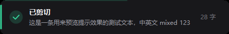
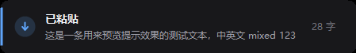
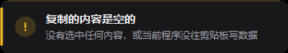

# CopyCheck · 复制核对

> 复制、剪切、粘贴之后，告诉你到底做成了没有、操作的是什么内容。

按快捷键弹提示的工具有不少，但绝大多数只做了一件事：**你按了键，它就夸你操作成功了**。

问题是——你按了键，和剪贴板真的被写入，是两件不同的事。远程桌面断连、程序禁止复制、剪贴板被占用的时候，按键照样会到达系统，提示照样会弹，而你的剪贴板其实一个字都没变。

CopyCheck 判断的不是「你按了键」，而是 **Windows 的剪贴板序列号到底动没动**。

## 支持的四种操作

| 操作 | 怎么触发 | 怎么判断 |
|---|---|---|
| **复制** | `Ctrl+C` | 剪贴板序列号是否变化 |
| **剪切** | `Ctrl+X` | 同上（剪切也会写剪贴板） |
| **粘贴** | `Ctrl+V` | 读剪贴板，告诉你粘的是什么 |
| **右键复制** | 右键菜单 / 程序内复制按钮 | 常驻监听剪贴板变化 |

## 六种提示

| 提示 | 含义 |
|---|---|
|  | 剪贴板确实更新了，下面显示内容前 34 字和字数 |
|  | 剪切成功，同样显示内容摘要 |
|  | **蓝色**：告诉你这次粘贴的是什么内容 |
|  | 写进去了，但和上次复制的一模一样 |
|  | 剪贴板被写了，但内容为空——通常是没选中任何东西就按了 Ctrl+C |
|  | 等满 2.6 秒剪贴板都没动，附一句可能原因 |

绿色 = 确实成功，蓝色 = 粘贴的内容，琥珀 = 有问题但不算失败，红色 = 真失败了。

## 为什么粘贴是蓝色的

因为**外部无法确认粘贴是否成功**。

粘贴是目标程序的行为：它可能接受、可能忽略、可能转换格式。CopyCheck 站在系统外面，只能看到「剪贴板里现在是什么」，看不到「目标窗口收下了什么」。

所以粘贴提示回答的是「你粘的是这个」，而不是「粘贴成功了」。用蓝色而不是绿色，就是为了不撒谎。

如果哪天你粘贴出来发现内容不对，看一眼提示就知道：是复制时就错了（绿色提示内容不对），还是粘贴环节出的问题（蓝色提示内容是对的）。

## 和同类工具的差别

| 工具 | 判断依据 | 复制失败时 | 显示复制内容 | 剪切/粘贴 |
|---|---|---|---|---|
| ClipPing | 剪贴板更新事件 | 什么都不显示 | 否 | 否 |
| Copytips | 剪贴板更新事件 | 什么都不显示 | 否 | 否 |
| **CopyCheck** | 键盘钩子 + 剪贴板序列号双重验证 | **明确报失败并给原因** | **是** | **是** |

前两个都是优秀的工具，如果你只需要「复制成功时的视觉反馈」，直接装 ClipPing 就行（`winget install KevinGosse.ClipPing`）。CopyCheck 解决的是另一半问题。

## 安装

**[下载 CopyCheck.exe](https://github.com/adam0718/copycheck/releases/latest)**，双击运行。

40KB 单文件绿色版，不需要安装，不需要 .NET 运行时（Windows 10 1809+ / Windows 11 系统自带 .NET Framework 4.8）。

## 托盘菜单

- **试一下提示效果** —— 子菜单里可以逐个预览六种状态，不用真的去复制
- **粘贴时提示** —— 关闭后 Ctrl+V 不再弹提示
- **检测右键复制** —— 关闭后只检测三个快捷键
- **跳过终端窗口** —— 默认开启。终端里 Ctrl+C 是中断信号不是复制
- **开机自启**

## 它怎么判断的

Windows 有个 API 叫 `GetClipboardSequenceNumber()`。剪贴板每被写入一次，这个数字就加一。

**复制 / 剪切**：

1. 键盘钩子捕获按键，记下当时的序列号 `S`
2. 每 45ms 查一次，序列号变成 `S+1` 以上 → 剪贴板被写入过，成功
3. 450ms 还没变 → 先提示「还没检测到更新」，但继续等
4. 2600ms 还没变 → 判定失败

第 3 步的「继续等」是专门为远程桌面设计的。RDP 的剪贴板走重定向，写入延迟可能到几百毫秒甚至更久，如果 450ms 就斩钉截铁报失败，会出现「刚说完失败马上又改口说成功」的尴尬。所以远程桌面会话下首个阈值自动放宽到 1200ms。

**右键复制**：没有按键事件，靠常驻监听序列号变化捕获。代价是分不清「用户主动复制」和「别的程序偷偷写剪贴板」——所以空内容和重复内容都会静默，避免骚扰。

**粘贴**：只读剪贴板，不做成功判定。

一个已验证的边界：**重复复制完全相同的内容时，序列号照样会递增**（因为写入动作本身被记录了）。这意味着「序列号没变」可以确定地等于「剪贴板没被写过」，不存在误判空间。

## 它管不了什么

诚实说明边界：

- **粘贴是否真的成功，无法确认。** 只能告诉你粘的是什么内容。
- **右键菜单的「剪切」会显示成「已复制」。** 剪贴板和复制写入的格式一样，从外部区分需要解析 `Preferred DropEffect`，只有部分程序会设置。
- **图片和文件只显示尺寸/数量，不显示内容。** 文本才有预览。
- **管理员权限的程序可能捕获不到按键。** 如果目标程序以管理员身份运行，而 CopyCheck 是普通权限，Windows 的 UIPI 机制会阻止低级键盘钩子收到它的按键。
- **不记录剪贴板历史。** 那是 Ditto / CopyQ / Win+V 的活。

## 隐私

CopyCheck 只读剪贴板内容用于生成提示文字，**不写任何文件、不联网、不留历史**。程序退出后提示文字随之消失。

配置存在 `%APPDATA%\CopyCheck\settings.ini`，只有几个开关值。

## 从源码构建

需要 .NET SDK（8.0 或更高，仅构建时需要；运行不需要）。

```bash
dotnet build src/CopyCheck.csproj -c Release
# 产物：src/bin/Release/net48/CopyCheck.exe —— 约 40KB
```

目标框架是 **.NET Framework 4.8**。Windows 10 1809+ 和 Windows 11 系统自带这个运行时，所以 40KB 的 exe 拷到任何现代 Windows 上双击就能跑，启动约 100ms。

> 为什么不用 .NET 8？试过两条路，都不通：自包含单文件 63MB；而单文件运行时会把内容自解压到临时目录，这个行为会被 Windows 的 Smart App Control 判定为可疑直接拦掉（`WinError 4551`）。改成目录发布能跑，但要 146MB / 242 个文件。net48 目标生成的 exe 没有自解压行为。取舍详见 `DECISIONS.md` 的 D-008 和 D-011。

## 验证

```bash
# 剪贴板序列号判据
python tests/verify_sequence.py

# 六种状态的渲染（用 --demo 模式，稳定可重复）
python tests/capture_states.py

# 真实按键路径：Ctrl+C / Ctrl+X / Ctrl+V / 右键复制
python tests/capture_actions.py
```

`tests/` 里的脚本需要 Python 3.10+，截图功能需要 pillow。

`CopyCheck.exe --demo=copy`（可选 `cut` / `paste` / `unchanged` / `empty` / `failed`）会直接渲染对应提示，用于预览或自动化测试。

## License

MIT
